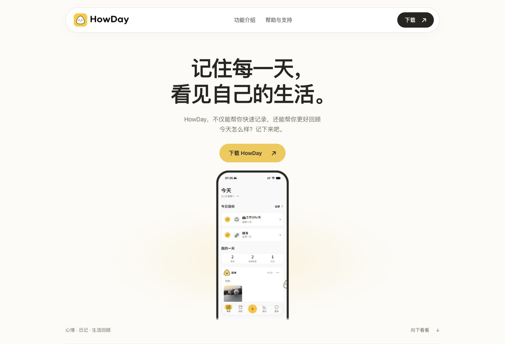

# App Website

**Agent Skill · App Website Development**

Build a product website around your real app.

An Agent Skill for turning verified app features, real screenshots, and brand assets into a clear, responsive product website—from the content outline to a browser-checked implementation.

## See the approach

[](https://howdayapp.com/)

[Visit HowDay](https://howdayapp.com/) · [Read the showcase notes](examples/howday.md)

HowDay is Jessica's existing app website and a reference for the approach. The image preserves its original Chinese interface; it is not an English localization or a fresh reproduction benchmark.

## Why use it?

App landing pages need more than a headline and a download button. Visitors need to understand the product, recognize what they will actually use, and find the right download destination. This skill connects each feature claim to a real product screen and keeps the website consistent across desktop and mobile.

## What you get

- A short product brief and page outline based on your actual app.
- A hero and one representative feature section before expanding the site, when review is requested.
- Consistent typography, feature cards, product framing, and responsive behavior.
- A working website in your existing stack, plus browser checks and a clear list of unfinished items.

## Quick start

Install with the [Skills CLI](https://github.com/vercel-labs/skills), using its supported Node.js version:

```bash
npx skills add JessicaLiu996/app-website --skill app-website
```

Choose your agent and open the website project. Then provide the app name, real icon/screenshots, supported features, and download link:

```text
Use $app-website to prepare a website for my app.
Use the product assets and feature notes in this project.
First propose the page structure and copy, then build the hero and one
feature section for desktop and mobile review. Keep the current stack.
```

The installable package is [`skills/app-website/`](skills/app-website/). You can also copy that entire directory into your agent's configured skill directory, then reload skills or start a new session. This package was prepared and checked in Codex; other clients have not been behaviorally tested.

## What to provide

| Input | Why it matters |
| --- | --- |
| App name, icon, wordmark, and brand assets | Keep the website recognizable and accurate |
| Current screenshots or screen recordings | Show the product as it actually works |
| Confirmed features and intended audience | Write claims the product can support |
| Real download and support destinations | Give visitors working next steps |
| Existing website source, if available | Reuse your stack and avoid rebuilding unnecessarily |

## Requirements and limitations

The agent needs access to the website source, your approved assets, and a browser for visual verification. Build tools depend on the existing project.

The skill provides a workflow and layout guidance, not a packaged website theme. It does not invent product features, redraw app interfaces, create an account backend, or deploy the website without authorization. HowDay's content and brand are examples, not defaults for other apps.

## Inside the skill

- [`SKILL.md`](skills/app-website/SKILL.md): product facts, layout, implementation, and acceptance workflow.
- [Structure and visual reference](skills/app-website/references/structure-and-visual.md): reusable layout guidance.

Created by [Jessica](https://github.com/JessicaLiu996). HowDay branding and product screenshots remain associated with HowDay.

## License

Skill instructions and source code are available under the [MIT License](LICENSE).
HowDay branding and product screenshots are excluded from this code license and remain associated with HowDay.
