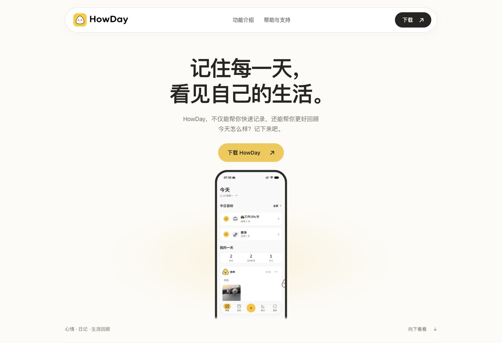

# HowDay showcase

[HowDay](https://howdayapp.com/) is Jessica's app for recording and revisiting everyday life. Its existing product website is used here as a visual reference, with the original product language preserved.

## What this example demonstrates

- A clear product introduction followed by a download destination.
- Real product visuals as the main evidence for feature claims.
- A coherent presentation of the app's identity and content.

## What carries over to another app

Reuse the method: verify product facts, choose the matching screenshots, organize the page, agree on a representative section, and check desktop/mobile behavior.

Replace the identity, screenshots, features, copy, navigation, and links with the new app's verified inputs. Do not reuse HowDay's brand or infer that another app has its features.

## Provenance and limits

The image is an existing showcase captured during preparation of Jessica's GitHub profile and provided here for presentation. It was not regenerated by this release test. This example does not provide the HowDay website source, an English version of its UI, or a fresh end-to-end website-build test.
